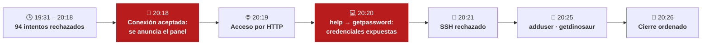

# GetDinosaur · Análisis forense de red

> Reconstrucción de una intrusión a partir de una captura de tráfico (PCAP) con Wireshark: desde 94 intentos de conexión rechazados hasta un panel de administración oculto que entrega las credenciales en texto plano.

## Contexto

| | |
|---|---|
| **Reto** | Dinosaur |
| **Plataforma** | ThePwnLab · *The Breach*, powered by The Bridge |
| **Formación** | Bootcamp de Ciberseguridad de The Bridge |
| **Categoría** | Seguridad en Redes |
| **Completado** | 24 de septiembre de 2026 |
| **Evidencia analizada** | `getdinosaur.pcapng` · 1.303 paquetes · 27/02/2026, 19:31:35 – 20:26:05 |

## Hallazgo principal

El servicio de `10.0.2.23:4444` **divulgó en texto plano** las credenciales `administrador` / `noteladigo` a `10.0.2.15` tras recibir el comando `getpassword`, sin ningún tipo de autenticación ni cifrado.

**Evidencia principal: paquete 1247.**

## Resumen de la intrusión

1. **Intentos iniciales:** `10.0.2.23:6666` intenta conectar con `10.0.2.15:3333` 94 veces; todas se rechazan con `RST, ACK`.
2. **Conexión aceptada (paquetes 486–489):** el intento número 95 completa el *three-way handshake* y anuncia *«Panel de administración en el puerto 4444»*.
3. **Panel por HTTP:** el puerto 4444 responde a un navegador con un panel de comandos en texto plano.
4. **Exposición de credenciales (paquete 1247):** `help` revela los comandos `adduser`, `getdinosaur` y `getpassword`; este último devuelve la contraseña del administrador.
5. **SSH rechazado (paquetes 1251–1252):** el puerto 22 del servidor responde `RST, ACK`.
6. **Última sesión:** se crea un usuario con `adduser` y se ejecuta `getdinosaur` («RAWR!»).

**Informe completo, paquete a paquete:** [reporte-de-intrusion.md](reporte-de-intrusion.md)

## Metodología

| Técnica de Wireshark | Para qué |
|---|---|
| Filtros por conversación (`tcp.stream eq N`) | Aislar cada sesión entre los dos equipos |
| *Seguir secuencia TCP* (ASCII) | Leer los comandos y respuestas del panel tal como viajaron |
| Lectura de *flags* TCP (`SYN`, `SYN-ACK`, `RST`, `FIN`) | Distinguir intentos rechazados, conexiones aceptadas y cierres |
| Marcas de tiempo y números de paquete | Construir una cronología verificable, donde cada afirmación cita su paquete |

## Lecciones

- **El texto plano lo cuenta todo.** Sin cifrado, cualquiera que capture el tráfico puede leer comandos y credenciales tal como se escribieron.
- **Un servicio en un puerto no estándar no está oculto.** El panel se anunció en la propia red y bastó con seguir la conversación.
- **El cambio de `RST` a `SYN-ACK` es la pista clave.** La captura demuestra *que* el puerto 3333 empezó a aceptar conexiones, pero no *por qué*: un buen informe separa lo que prueba la evidencia de lo que no.

## Nota

El análisis y las capturas de pantalla son trabajo propio. El archivo PCAP es material del reto y no se incluye en el repositorio. Las credenciales que aparecen forman parte del escenario del laboratorio.
