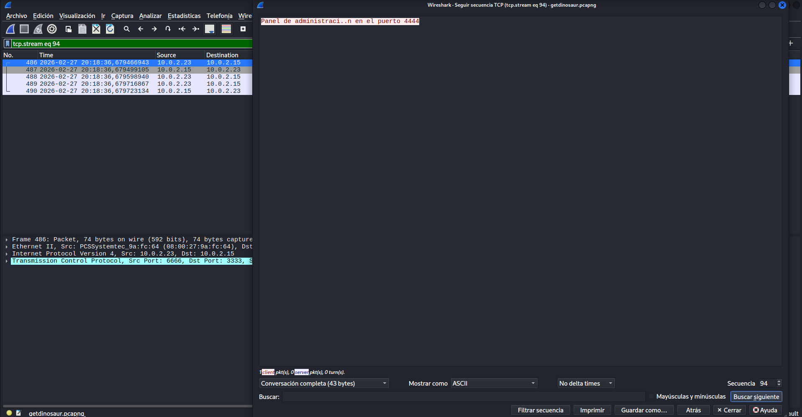
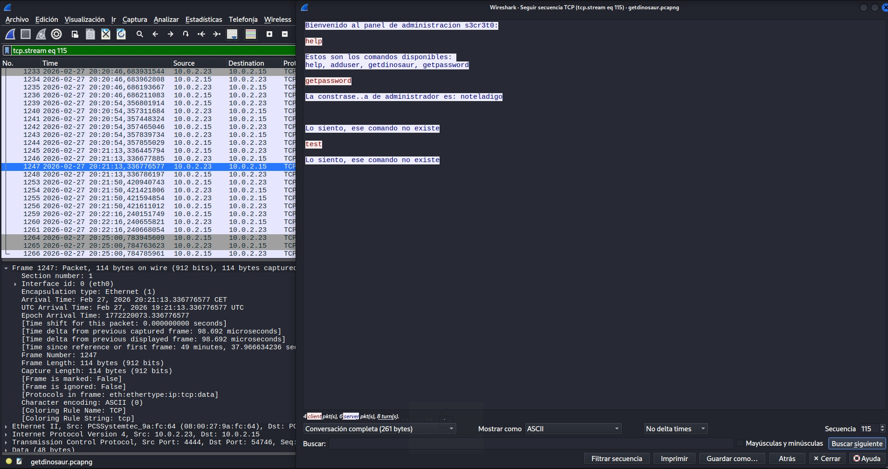
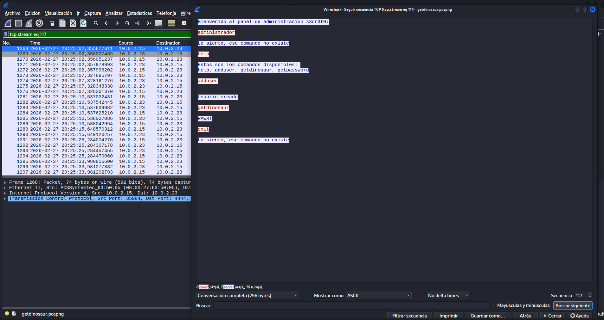
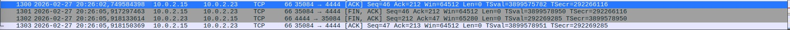
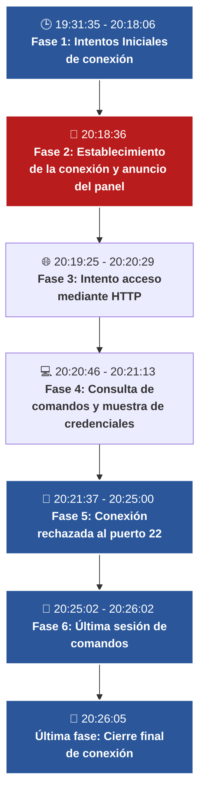

# GetDinosaur — Reporte de intrusión

## Datos de la captura

- **Fecha de análisis:** 25 de septiembre de 2026. 

- **Fecha de los eventos:** 27 de febrero de 2026. 

- **Contenido del archivo:** 1.303 paquetes y abarca desde las 19:31:35.370 hasta las 20:26:05.918. 

- **IP observadas:** Conexión entre 10.0.2.15 y 10.0.2.23 desde el primer contacto hasta el cierre final.

## Cronología

### Intentos iniciales de conexión

El primer contacto aparece a las 19:31:35 en el **paquete 1**: 

- 10.0.2.23:6666 envió un SYN a 10.0.2.15:3333.

El **paquete 2** contiene:

- Respuesta RST, ACK desde 10.0.2.15:3333 hacia 10.0.2.23:6666, que rechazó el intento de establecer la conexión.

Entre las 19:31:35 y las 20:18:06 se registran 94 intentos SYN y sus 94 respuestas RST, ACK, sin datos de aplicación en esos intercambios. Los últimos dos paquetes de esta serie son el **484** y el **485**.

### Establecimiento de la conexión y anuncio del panel

A las 20:18:36, cambió la respuesta a los intentos de conexión: 

- En el **paquete 486**, 10.0.2.23:6666 envió SYN a 10.0.2.15:3333. 
   
+ En el **paquete 487**, 10.0.2.15:3333 respondió SYN, ACK, en lugar del RST, ACK observado anteriormente. 
   
- El **paquete 488** contiene el ACK de 10.0.2.23 que completa el establecimiento de la conexión TCP en tres pasos. La captura demuestra que este intento fue aceptado, pero no explica qué cambio en el equipo o en la red lo hizo posible.

- En el **paquete 489**, dentro de esa conexión, 10.0.2.23:6666 envió a 10.0.2.15:3333 el mensaje: «Panel de administración en el puerto 4444». 

«Evidencia del anuncio del panel».

### Intento de acceso mediante HTTP

Siguiendo el puerto 4444, **paquete 1064**, a las 20:19:25:

- El equipo 10.0.2.15:42296 envió una petición «GET / HTTP/1.1» a 10.0.2.23:4444. La cabecera User-Agent indicaba Mozilla Firefox. El servidor respondió con una bienvenida al panel y varios mensajes «Lo siento, ese comando no existe». 

A las 20:20:29, el cliente inició el cierre de la conexión. Los **paquetes 1149**, **1150** y **1151** muestran la secuencia FIN, ACK; FIN, ACK; ACK.

### Consulta de comandos y muestra de credenciales

A las 20:20:46 comenzó una nueva conexión al mismo servicio, desde 10.0.2.15:54746 hacia 10.0.2.23:4444, en el **paquete 1232**.

A las 20:20:54, el cliente envió el comando `help` en el **paquete 1239**. El servidor respondió en los **paquetes 1241** y **1243** con los comandos disponibles: «help, adduser, getdinosaur, getpassword».

A las 20:21:13, el cliente envió `getpassword` en el **paquete 1245**. El servidor respondió en el **paquete 1247** indicando que la contraseña de «administrador» era «noteladigo», **todo en texto plano.**

«Respuesta del servidor que expone las credenciales; paquete 1247».

### Conexión rechazada al puerto 22

A las 20:21:37, el equipo 10.0.2.15:37844 intentó iniciar otra conexión TCP hacia 10.0.2.23:22. 
El **paquete 1251** contiene un SYN y el **paquete 1252** una respuesta RST, ACK con origen 10.0.2.23:22. La conexión fue rechazada antes de establecerse. 

A las 20:21:50, el cliente envió un salto de línea  y recibió un error de comando no reconocido (**paquetes 1253 y 1255**). A las 20:22:16 envió `test` y obtuvo el mismo tipo de error (**paquetes 1259 y 1260**).

A las 20:25:00 terminó la conexión FIN, ACK; FIN, ACK; ACK de los **paquetes 1264**, **1265** y **1266**. El cierre fue iniciado por 10.0.2.15.

«Paquete 1252, evidencia conexión rechazada al puerto 22».

### Última sesión de comandos

A las 20:25:02, en el **paquete 1268**, comenzó otra conexión al panel, desde 10.0.2.15:35084 hacia 10.0.2.23:4444. 

A las 20:25:07, en el **paquete 1275**, el cliente envió el texto «administrador» en el paquete 1273, pero el servicio lo rechazó como un comando inexistente. 

A las 20:25:10 se volvió a consultar `help` y el servidor devolvió la lista de comandos (paquetes 1281, 1283 y 1285).

A las 20:25:15, el cliente envió `adduser` en el **paquete 1289**. A las 20:25:25 envió un salto de línea en el paquete 1291 y el servidor respondió «Usuario creado» en el **paquete 1293**. 

A las 20:25:33, el cliente envió `getdinosaur` en el **paquete 1295** y el servidor respondió «RAWR!» en el **paquete 1296**. 

A las 20:26:02, el cliente envió `exit` en el **paquete 1298**. El servicio respondió «Lo siento, ese comando no existe» en el **paquete 1299**. Por tanto, el texto `exit` no fue reconocido como un comando válido.

«Imagen del panel de administración s3cr3to; paquete 1268».

### Cierre final de la conexión

A las 20:26:05 terminó la conexión mediante un cierre ordenado. En el **paquete 1301**, 10.0.2.15:35084 envió FIN, ACK a 10.0.2.23:4444, iniciando el cierre. En el **paquete 1302**, el servidor respondió FIN, ACK. Finalmente, en el **paquete 1303**, el cliente confirmó con ACK. Estos paquetes muestran un cierre iniciado desde el lado del cliente, sin un RST en esta secuencia. 

«Respuesta del servidor que expone las credenciales; paquete 1247».

### Conclusión

El servicio de 10.0.2.23:4444 divulgó en texto plano las credenciales «administrador» / «noteladigo» a 10.0.2.15 tras recibir `getpassword`. **La evidencia principal es el paquete 1247**.

### Línea Temporal

